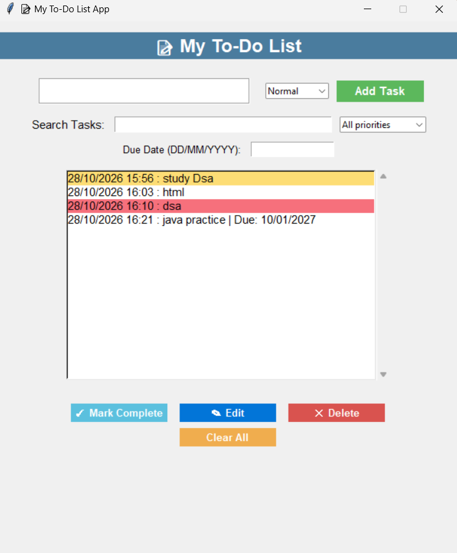

# 📝 Python To-Do List App

A desktop task management application built with Python and Tkinter. Organize daily tasks, assign priorities, set due dates, and track completed and overdue tasks through a simple graphical interface.

## Features

- **Task Management:** Add, edit, delete, and complete tasks.
- **Priority Levels:** Assign Normal, Important, or Urgent priority to each task.
- **Task Search:** Find tasks by name as you type.
- **Priority Filtering:** Filter tasks by priority.
- **Due Dates:** Set due dates using the `DD/MM/YYYY` format.
- **Overdue Highlighting:** Display overdue tasks in red.
- **Persistent Storage:** Save tasks locally in a JSON file.
- **Completion Status:** Mark completed tasks with a checkmark and grey text.
- **Automatic Saving:** Save task changes when you add, edit, complete, or delete tasks.

## Tech Stack

- **Language:** Python 3
- **GUI:** Tkinter and ttk
- **Data Storage:** JSON
- **Libraries:** `json`, `os`, `datetime`, and `time`

## Application Preview

Add a screenshot of your application to the `images` directory and save it as `todo_screenshot.png`.



## Installation and Setup

### 1. Clone the repository

```bash
git clone https://github.com/shobhakumari12/To_do_List.git
cd To_do_List
```

### 2. Check Python

```bash
python --version
```

Python 3 is required. Tkinter is included with most standard Python installations.

### 3. Run the application

```bash
python todolist.py
```

## How to Use

1. Enter a task in the input field.
2. Select its priority.
3. Optionally enter a due date in `DD/MM/YYYY` format.
4. Click **Add Task**.
5. Search for tasks or filter them by priority.
6. Select a task to mark it complete, edit it, or delete it.
7. Close and reopen the application to access saved tasks.

## Project Structure

```text
To-Do-List/
├── images/
│   └── todo_screenshot.png
├── todolist.py
├── tasks.json
├── README.md
└── .gitignore
```

`tasks.json` is created when tasks are saved. Include it in `.gitignore` if you don't want to publish your personal task data.

## Data Storage

The application stores tasks locally in `tasks.json`. It loads saved tasks when the application starts and saves changes automatically.

No internet connection or external database is required to run the application.

## Future Improvements

- Sort tasks by due date or priority.
- Add task categories.
- Export tasks to CSV.
- Add desktop reminders.
- Improve the interface with themes and responsive layouts.
- Add automated tests.

